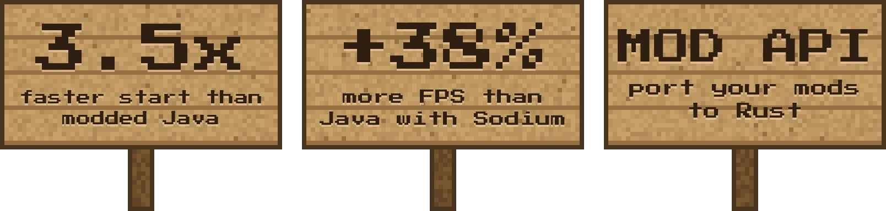
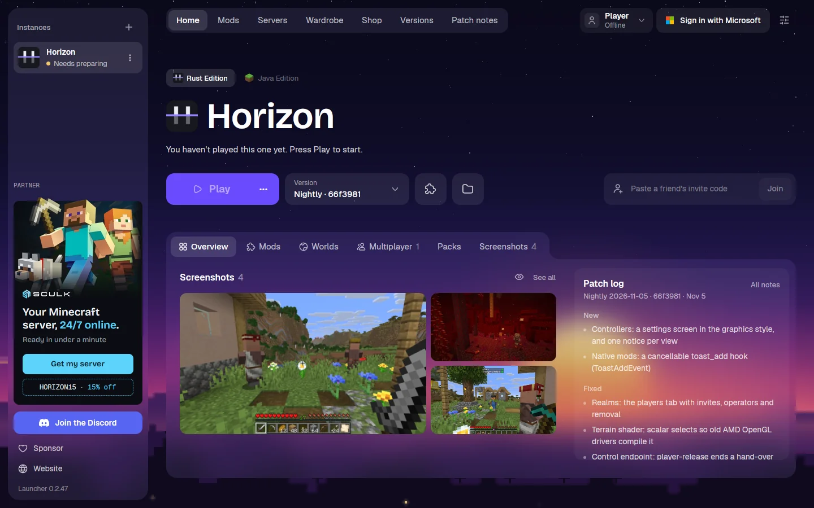
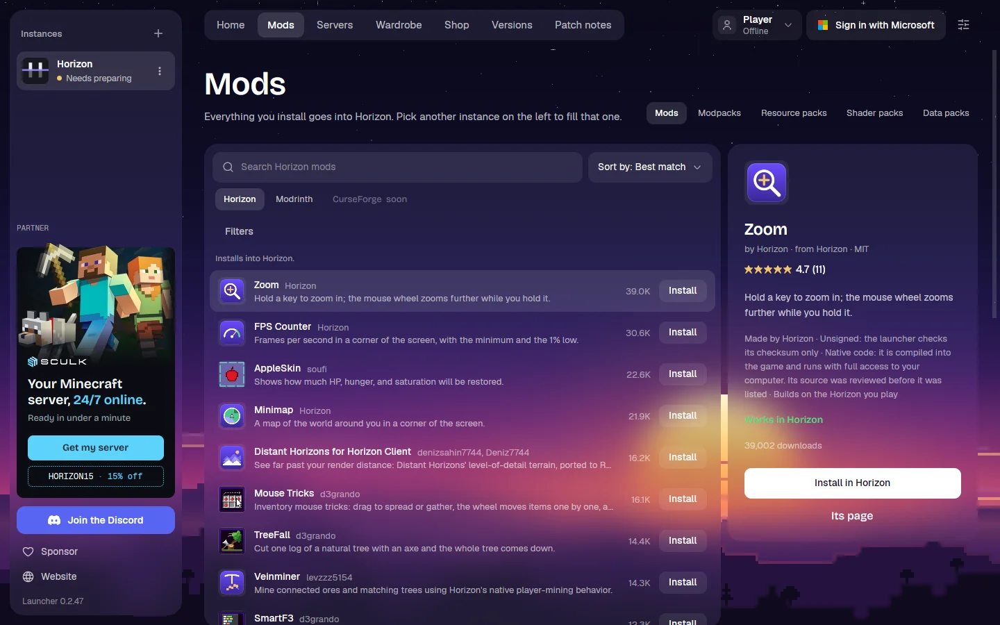
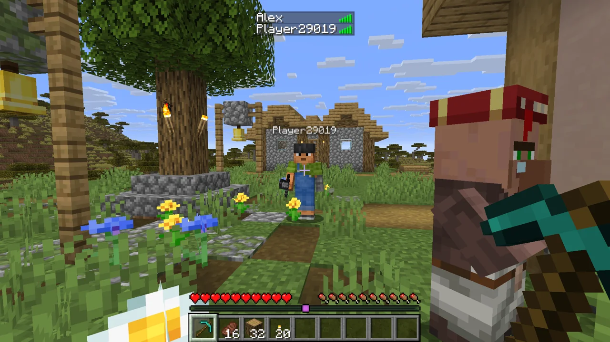
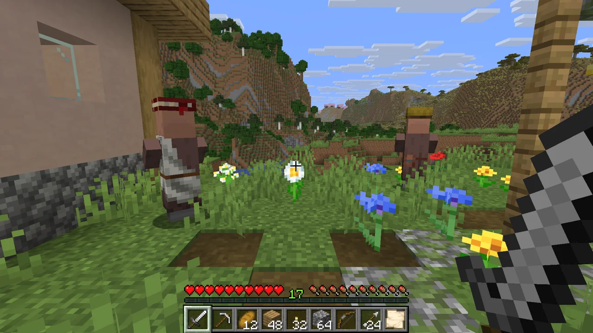
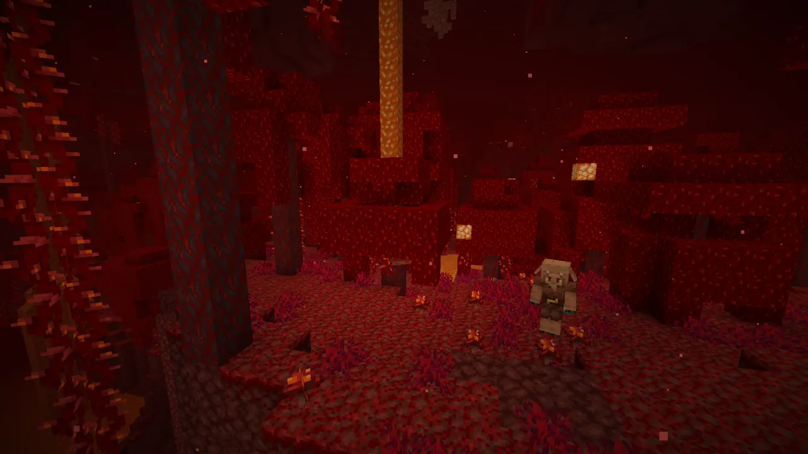
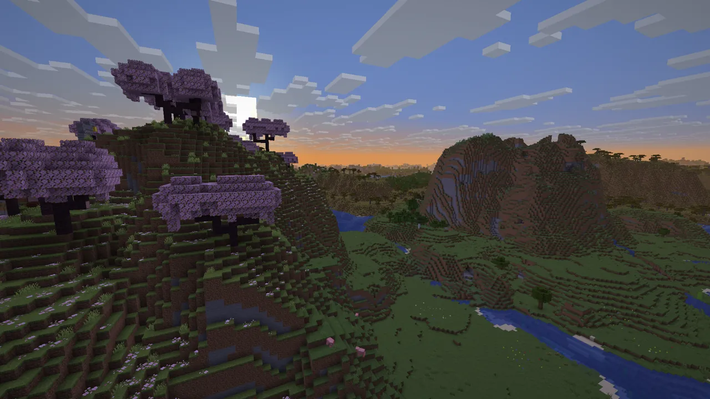

<p align="center"><strong>English</strong> · <a href="README.ru.md">Русский</a></p>

<p align="center">
  <a href="https://github.com/horizon-rust/horizon"></a>
  &nbsp;&nbsp;&nbsp;&nbsp;
  <a href="https://ely.by"></a>
</p>

<h1 align="center">Elyhorizon</h1>

<p align="center">
  <b>Minecraft 26.3, rewritten from scratch in Rust — with Ely.by accounts.</b><br>
  An independent fork of <a href="https://github.com/horizon-rust/horizon">Horizon</a>. Play on existing worlds and servers.
</p>

<p align="center">
  <a href="https://github.com/kkerneldev/Elyhorizon/actions/workflows/elyhorizon-release.yml"></a>
  
  
  
  
  <a href="LICENSE"></a>
</p>

<p align="center">
  <a href="https://github.com/kkerneldev/Elyhorizon/releases"><b>Download</b></a> ·
  <a href="#download-and-install"><b>Install</b></a> ·
  <a href="docs/elyby-account.md"><b>Ely.by setup</b></a> ·
  <a href="docs/elyhorizon-releases.md"><b>Build a release</b></a> ·
  <a href="https://github.com/kkerneldev/Elyhorizon/issues"><b>Report an issue</b></a> ·
  <a href="https://playhorizon.dev/docs/"><b>Upstream docs</b></a>
</p>

<p align="center">
  
</p>

<p align="center">
  
</p>

<p align="center">
  <sub>*Upstream's measurement against Java Edition with Sodium, Lithium, FerriteCore and ImmediatelyFast on a Ryzen 7 9800X3D with an RTX 5080. More computers on the <a href="https://playhorizon.dev/benchmarks">benchmarks page</a>.</sub>
</p>

<h2 align="center">What you get</h2>

- **Vanilla Minecraft:** survival, creative and hardcore in every dimension, with the same terrain, mobs, villagers and redstone. Your saves open as they are.
- **Ely.by accounts:** sign in through your system browser, choose an account, and play with your own name and skin. Java instances get authlib-injector. See [Ely.by setup](docs/elyby-account.md).
- **Multiplayer:** vanilla and Horizon servers, LAN, and invite codes for playing your world with friends. You can [host a server](docs/hosting.md) too.
- **Mods:** Horizon's own mod system, with mods like zoom and a minimap, and shader packs. Browse the [catalogue](https://playhorizon.dev/mods) or [make a mod](docs/mods.md).
- **Beyond vanilla:** terrain up to 1,024 chunks away, HDR, controller support, graphics presets and dynamic lights.
- **Dedicated server:** server software for high performance, low memory usage, and near instant startup. See [the server benchmark](docs/performance/server-vs-vanilla.md).

<h2 align="center">What you need</h2>

- **Your own copy of Minecraft: Java Edition.** Elyhorizon ships no Minecraft files. It builds them from the game you bought, so install version 26.3 and start it once.
- **An account:** Ely.by, or a Microsoft account that owns Minecraft. Ely.by accounts work on servers set up for Ely.by authentication.
- **Windows, macOS or Linux:** Windows on x64, macOS 12 or later on Apple Silicon and Intel, Linux on x86-64.

## About this fork

**Elyhorizon is a separate Horizon distribution with Ely.by integration.** It is
built on the original Horizon Rust client. This fork adds browser sign-in with
Ely.by, passes your account name and UUID to the game, loads skins, and provides
a Windows installer that installs the launcher alongside its matching client.

This project is developed independently of the Horizon and Ely.by teams. The
logos identify the projects behind the integration and do not imply an official
partnership.

| Feature | What Elyhorizon provides |
| --- | --- |
| Ely.by accounts | Sign in through your system browser, select an account, and refresh sessions |
| Player name and skin | Pass the selected account to Horizon and load textures from Ely.by |
| Minecraft Java | Use authlib-injector for Java instances launched with Ely.by |
| Installation | Windows setup, Linux AppImage and macOS DMG, each including the matching Horizon client |
| Portable launch | Windows/macOS ZIP and Linux tar.gz packages containing both executables |
| Release builds | GitHub Actions builds Windows, Linux and both Mac architectures, checks packages, and publishes the files |

## Supported platforms

| Platform | Architecture / baseline | Downloads |
| --- | --- | --- |
| Windows | x64 | Installer EXE, portable ZIP |
| Linux | x86_64, glibc 2.35+; Ubuntu 22.04+, Debian 12+, current Arch and compatible Fedora | AppImage, tar.gz |
| macOS | Apple Silicon (arm64) and Intel (x64); macOS 12+ build target | DMG, app bundle ZIP |

Package startup checks run in GitHub Actions. macOS checks use macOS 15 runners;
compatibility with older macOS versions, graphics and interactive browser sign-in
must also be verified on the target machine.

## Download and install

### Windows

1. Open [this fork's Releases](https://github.com/kkerneldev/Elyhorizon/releases).
2. Download **`Elyhorizon-<version>-windows-x64-setup.exe`**.
3. Run the installer, choose a folder, and optionally add a desktop shortcut.
4. Open **Elyhorizon** from the Start menu, add your Ely.by account, and select it before playing.

The installer runs for the current user without administrator access. It places
both executables together and adds an uninstall entry to Windows Installed Apps.
You need Windows x64 and a GPU suitable for Horizon.

For a portable setup, download `Elyhorizon-<version>-windows-x64.zip`, extract
**the entire folder**, and run `horizon-launcher.exe`. Keep `horizon-launcher.exe`
and `horizon-client.exe` together so the launcher can use the client with Ely.by
support. Imported builds and builds with native mods use their own executable.

If no downloads are available yet, run the
[release workflow](docs/elyhorizon-releases.md) in your GitHub repository first.

### Linux: Arch, Ubuntu, Debian, Fedora and compatible distributions

Download `Elyhorizon-<version>-linux-x86_64.AppImage` from Releases, then run:

```sh
chmod +x Elyhorizon-<version>-linux-x86_64.AppImage
./Elyhorizon-<version>-linux-x86_64.AppImage
```

The AppImage contains the launcher, matching Horizon client and bundled application
libraries. It targets desktop systems with glibc 2.35 or newer: Ubuntu 22.04+,
Debian 12+, current Arch and compatible Fedora releases. Graphics drivers must
come from your distribution. If FUSE is unavailable, add `--appimage-extract-and-run`.

A `linux-x86_64.tar.gz` is also available. Extract the entire folder and run
`./horizon-launcher`, keeping `horizon-client` beside it. This archive relies on
system libraries; the AppImage is the recommended portable download.

### macOS: Apple Silicon and Intel

Choose `macos-arm64.dmg` for Apple Silicon (M1/M2/M3 and later) or `macos-x64.dmg`
for an Intel Mac. Open the DMG and drag **Elyhorizon.app** into **Applications**.
A ZIP of the same app is also available. Both the launcher and matching Horizon
client are inside the app bundle; keep the bundle intact.

These builds are ad hoc signed, not Apple-notarized. macOS may require explicit
approval in **System Settings → Privacy & Security** before first launch.

## Sign in with Ely.by

Authentication opens the Ely.by website in your browser. Enter your password and
two-factor code on the website; tokens are saved in your system credential store.

Release maintainers register a public Desktop application once and compile its
public ID into the launcher through GitHub Actions Variables. End users do not
configure environment variables or client secrets. The local browser flow uses
S256 PKCE and a loopback callback, with no separately hosted backend.
See [account setup and release verification](docs/elyby-account.md).

Ely.by provides accounts and textures. Minecraft files, libraries, and resources
are downloaded from official sources or reused from an existing installation.
They are not included in the Elyhorizon installer.

Ely.by accounts work with servers configured for Ely.by authentication.
Access to servers using Microsoft authentication depends on that server's requirements.

## A look at Horizon

These upstream Horizon screenshots show the base interface and game on which
this fork is built.

<table>
  <tr>
    <td width="50%" align="center"></td>
    <td width="50%" align="center"></td>
  </tr>
  <tr>
    <td width="50%" align="center"></td>
    <td width="50%" align="center"></td>
  </tr>
  <tr>
    <td width="50%" align="center"></td>
    <td width="50%" align="center"></td>
  </tr>
</table>

## Build a release with GitHub Actions

Open **Actions → Elyhorizon release → Run workflow**, enter a new
version such as `0.2.1`, and enable `publish`. You can also push a tag such as
`elyhorizon-v0.2.1`.

A successful build publishes the installer, portable ZIP, and `SHA256SUMS` to
Releases. Actions tests the installer by installing it, checking the hashes of
both executables, and uninstalling it. See the
[release guide](docs/elyhorizon-releases.md) for details.

## Build from source

Development requires Rust, Python 3.10+, and JDK 25. Game resource preparation is
described in the [client documentation](docs/native-client.md) and
[CONTRIBUTING.md](CONTRIBUTING.md).

```sh
git clone https://github.com/kkerneldev/Elyhorizon.git
cd Elyhorizon
cargo build --release --locked -p horizon-official --bin horizon-official
cp target/release/horizon-official target/release/horizon-client
cargo build --manifest-path launcher/Cargo.toml --release --locked --bin horizon-launcher
```

`horizon-official` is the game with Horizon's own in-game parts built in
([docs/layers.md](docs/layers.md)); the launcher and players know it as
`horizon-client`. Place the built `horizon-launcher` and `horizon-client` in the
same folder to use Ely.by support. Prepared game files are stored separately in
the ignored `.local/` directory; never add them to the repository.

## Issues and contributions

Report problems with Ely.by sign-in, the installer, or changes in this fork in
[Elyhorizon Issues](https://github.com/kkerneldev/Elyhorizon/issues).
Include the build version, the action that triggered the issue, and the error
message. Do not include passwords, tokens, or the OAuth application secret.

Upstream engine documentation: [Horizon](https://github.com/horizon-rust/horizon),
[architecture](docs/architecture.md), [mods](docs/mods.md),
[servers](docs/hosting.md), and [horizon-ctl control](docs/agent-control.md).

<h2 align="center">Horizon is made by the Horizon Team</h2>

<table align="center">
  <tr>
    <td align="center" width="140"><a href="https://github.com/kacpherek"><br><b>Kacper</b></a></td>
    <td align="center" width="140"><a href="https://github.com/Online5277"><br><b>Cosmic</b></a></td>
    <td align="center" width="140"><a href="https://github.com/levzzz5154"><br><b>levzzz</b></a></td>
    <td align="center" width="140"><a href="https://github.com/rdbtCVS"><br><b>rdbt</b></a></td>
    <td align="center" width="140"><a href="https://github.com/dezer-x"><br><b>Anthony S</b></a></td>
    <td align="center" width="140"><a href="https://github.com/NikitaMGrimm"><br><b>Nikita</b></a></td>
    <td align="center" width="140"><a href="https://github.com/ludovic111"><br><b>Ludovic Marie</b></a><br><sub>Founder</sub></td>
  </tr>
</table>

<p align="center">
  <sub>and everyone who has contributed</sub><br><br>
  <a href="https://github.com/horizon-rust/horizon/graphs/contributors"></a>
</p>

<p align="center">
  <a href="docs/native-client.md#run-from-a-checkout"><b>Build guide</b></a> ·
  <a href="CONTRIBUTING.md"><b>Contributing</b></a> ·
  <a href="GOVERNANCE.md"><b>Governance</b></a>
</p>

## Credits and license

- **Horizon** is the original project by [Ludovic Marie](https://github.com/ludovic111) and [Horizon contributors](https://github.com/horizon-rust/horizon/graphs/contributors).
- **Elyhorizon** is [this fork](https://github.com/kkerneldev/Elyhorizon), adding Ely.by support and its own Windows distribution.
- **Ely.by** is the [account and skin service](https://ely.by) used by the integration.

Source code is distributed under the [GNU LGPL, version 3 or later](LICENSE), for
the project's original work. Code merged before the move from MIT stays available
under the [MIT licence](LICENSES/MIT.txt); dependencies retain their own licenses
([notices](THIRD_PARTY_NOTICES.md)). Horizon and Ely.by logos belong to their
respective projects; see [image sources](docs/media/elyhorizon/README.md).

<sub>NOT AN OFFICIAL MINECRAFT PRODUCT. NOT APPROVED BY OR ASSOCIATED WITH MOJANG OR MICROSOFT. Minecraft is a trademark of Mojang Synergies AB; its code and assets belong to Mojang and Microsoft under the [Minecraft EULA](https://www.minecraft.net/en-us/eula).</sub>

<details>
<summary>Upstream Horizon technical audit</summary>

The audit below is preserved from the upstream README. Its date is stated in the
report; the results cover that test suite, not every scenario in this fork.

<p>
  
  
</p>

## Project status

**Player-visible gaps: 833 open** of the 833 the [port ledger](tools/port_ledger.py) found, reading every vanilla 26.3 method against Horizon's code: vanilla behaviour a player would notice that Horizon doesn't have yet. By area: Screens, HUD and client packets [197](https://github.com/horizon-rust/horizon/issues/3518); Entity and block rendering, models [129](https://github.com/horizon-rust/horizon/issues/3519); Animals [110](https://github.com/horizon-rust/horizon/issues/3512); Server and players on the server [106](https://github.com/horizon-rust/horizon/issues/3520); Blocks, redstone and fluids [86](https://github.com/horizon-rust/horizon/issues/3516); Entities, projectiles, vehicles and decorations [64](https://github.com/horizon-rust/horizon/issues/3514); Monsters and bosses [53](https://github.com/horizon-rust/horizon/issues/3513); Mob AI, villagers and raids [35](https://github.com/horizon-rust/horizon/issues/3521); World, world generation and saves [32](https://github.com/horizon-rust/horizon/issues/3517); Items, enchantments and inventories [21](https://github.com/horizon-rust/horizon/issues/3515). This number goes down as gaps close (`tools/parity_gaps.py`); the harness results below say that what is tested matches.

The table is the project's own audit: every subsystem matches vanilla in every harness that compares it. 100% means 100% of what the harnesses compare, not that nothing else differs.

### Java parity: 100%

Scores: 0 (absent), 0.25 (started), 0.5 (playable, major features missing), 0.75 (mostly complete) or 1 (complete and verified by differential tests); the percentage is their average. Last audited 2026-10-13: all 281 harnesses pass on Linux and macOS. The [port ledger](tools/port_ledger.py) adds a method-by-method view of what is ported.

| Subsystem | Score | Main gaps |
| --- | ---: | --- |
| Window, input and game loop | 1 | None: game loop, options, camera, auto-jump, toggle sprint/sneak and frame limiter match |
| Assets and resources | 1 | None: item models match over 196,290 stacks; the resource pack screen over 3,000 sessions |
| Network protocol and multiplayer | 1 | None: joins vanilla servers; the dedicated server matches vanilla's files, login, configuration, play and command tree; LAN discovery over 462 cases (offline mode only) |
| Chunk storage and palettes | 1 | None: client and saves share paletted containers, identical to vanilla over 266 scenarios |
| Section meshing | 1 | None: 112 scenes and over a million quads identical to vanilla |
| Rendering | 1 | None: entity models, block entity renderers (407 cases) and animations (296), HUD overlays (2,200 states), the recipe book (600), player list, subtitles and world border match |
| Lighting | 1 | None: saved and relit light matches vanilla, slabs and stairs included |
| World generation | 1 | None: 2,352 whole chunks over 225 structure sites, in all three dimensions, identical to vanilla |
| Region files and saves | 1 | None: saves round-trip with vanilla; worlds from 1.8 to 26.2 upgrade as vanilla's DataFixers do |
| Entities and physics | 1 | None: attributes, spawn rules, natural spawning (15,500 cases), raids and patrols (1,900), `finalizeSpawn` (24,000) and mob AI (92 scenarios) match |
| Interaction and inventory | 1 | None: menu clicks over 8,000 sequences; recipe book placement (6,000), buttons (1,200), saved book (1,500), loom and crafter screens (1,600) |
| Menus, HUD and chat | 1 | None: every command (758 over 39,685 inputs), scoreboards (81,000 operations), the player list (872,000 draw calls), chat and its suggestions (3,000 sessions) match |
| Audio | 1 | None: the sound engine, sound events, music, situational music, ambience and subtitles match vanilla |
| Block behaviours and ticking | 1 | None: block updates, random ticks, redstone, dispensers (6,000 cases), crafters (4,000), container spills (4,000), copper golems and the sculk family (435 scenarios) match |

</details>

See the [0.2.2 verification checklist](docs/elyhorizon-0.2.2-verification.md) for clean-install testing, authentication diagnostics and current verification limits.
